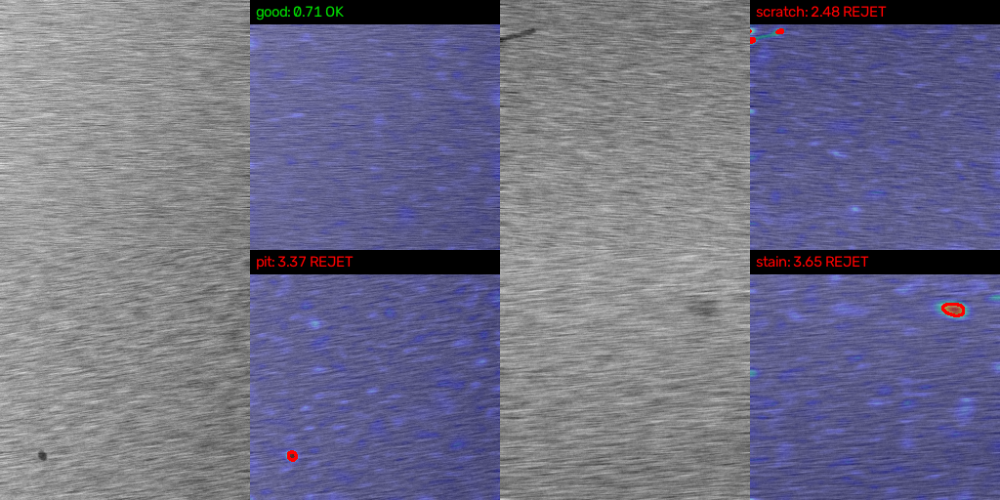
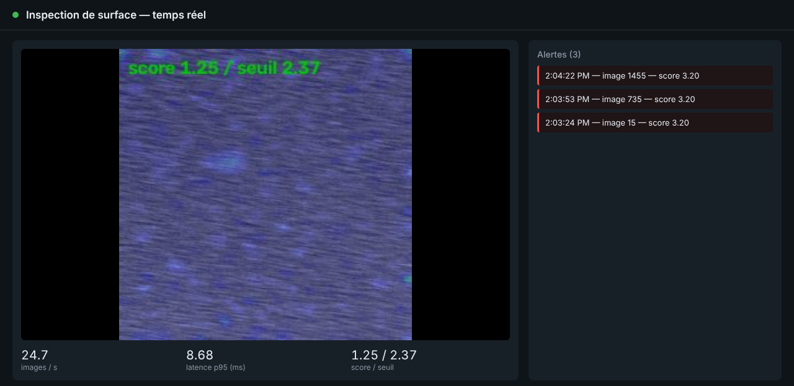

# Surface Inspection RT

Real-time visual inspection of industrial surfaces: an **RTSP camera stream** goes through a
**convolutional auto-encoder trained only on good parts**, anomalies are localized on a heat map,
and **alerts are pushed to a web dashboard**. Packaged with Docker; the inference image runs on
ONNX Runtime, and the same ONNX model can be compiled to TensorRT for an NVIDIA Jetson.


*Left: input frame. Right: anomaly heat map, red contour = region above threshold.*


*The dashboard running on the simulated production line: annotated stream, FPS, latency, alerts.*

## Results

Measured with the scripts in this repo (`make all`), synthetic brushed-metal dataset,
200 good + 200 defective test images (50 each: scratch, pit, crack, stain).

| Metric | Value |
|---|---|
| Image-level AUROC (good vs defective) | **0.946** |
| Pixel-level AUROC (defect localization) | **0.943** |
| False-reject rate (threshold = p99.5 of good validation parts) | 1.0% |
| Defects detected at that threshold | 49.5% |
| Latency per frame, ONNX Runtime, **1 CPU core** (Xeon 2.3 GHz) | **3.2 ms p50 / 3.4 ms p95** |
| Same, PyTorch | 5.0 ms p50 / 6.4 ms p95 |
| End-to-end service on a 25 fps stream | 25 fps sustained, 6.5 ms p95 |
| Model size | 0.87 M parameters |

| Defect type | AUROC | Detected at 1% false rejects |
|---|---|---|
| Pit | 0.992 | 78% |
| Crack | 0.949 | 34% |
| Scratch | 0.935 | 46% |
| Stain | 0.906 | 40% |

**Reading these numbers honestly.** AUROC says the scores separate good and bad parts well. The
detection rate at a *strict* 1% false-reject threshold is lower because the defects are
deliberately subtle (low contrast on a noisy texture). The threshold is a quality decision:
`python scripts/calibrate.py --percentile 95` trades more false rejects for more detections.
Latency covers preprocessing + inference + scoring (not video decoding), measured over 500
frames after warm-up (`scripts/benchmark.py`).

## Architecture

```
 camera ──RTSP──▶ LatestFrameReader ──▶ preprocess ──▶ auto-encoder ──▶ residual ──▶ score ──▶ AlertManager ──▶ WebSocket
 (GigE/IP)        (thread, keeps only     (gray,         (ONNX Runtime   multi-scale   top 0.2%   (3 frames in a     /api/alerts
                   the latest frame,       128x128)       or PyTorch)    normalized    pixels      row + cooldown)
                   auto-reconnect)                                                                                    │
                                                         annotated frame (heat map + contours) ──▶ /video.mjpg ◀─────┘ dashboard
```

| Module | Role |
|---|---|
| `inspector/stream.py` | Threaded RTSP/file reader, 1-frame buffer (no latency build-up), reconnection |
| `inspector/model.py` | Conv auto-encoder, 4 down-sampling stages, 8x8 bottleneck |
| `inspector/scoring.py` | Optional full-resolution tiling, multi-scale residual, threshold calibration |
| `inspector/backends.py` | Same interface for PyTorch and ONNX Runtime |
| `inspector/alerts.py` | Debounce (N consecutive frames) and cooldown |
| `inspector/pipeline.py` | Inference loop, latency/FPS statistics |
| `inspector/web.py` | FastAPI: dashboard, MJPEG stream, REST, WebSocket alerts |

The design choices (why unsupervised, why blur the residual before squaring, why a 1-frame
buffer, down-scaling vs tiling with measurements...) are explained in
[docs/DESIGN.md](docs/DESIGN.md).

## Quick start

```bash
pip install -r requirements-dev.txt

make data     # synthetic dataset, MVTec AD layout (data/train/good, data/test/<defect>, ...)
make train    # trains on good parts only, calibrates the threshold (~4 min on CPU)
make export   # ONNX export + numerical check against PyTorch
make eval     # metrics -> results/metrics.json
make bench    # latency -> results/benchmark.json
make video    # demo video simulating a production line (15% defective parts)

make run      # dashboard on http://localhost:8000, reading the demo video
```

### With Docker (RTSP server + simulated camera + inspection service)

```bash
make data train export video
docker compose up --build      # then open http://localhost:8000
```

`docker-compose.yml` starts a MediaMTX RTSP server, an FFmpeg container that streams the demo
video like a camera, and the inspection service reading `rtsp://rtsp:8554/line1`. To use a real
camera, set `STREAM_SOURCE=rtsp://<camera-ip>/<path>`.

### On an NVIDIA Jetson

```bash
trtexec --onnx=models/autoencoder.onnx --saveEngine=models/autoencoder_fp16.engine --fp16
```
ONNX Runtime can also use TensorRT directly through its `TensorrtExecutionProvider`.

## Using your own images

Put defect-free images in `data/train/good` and `data/val/good` (and optionally labeled test
images in `data/test/<defect>` with masks in `data/ground_truth/<defect>`), then `make train
export eval`. The layout is the same as the MVTec AD benchmark.

## API

| Endpoint | Description |
|---|---|
| `GET /` | Dashboard |
| `GET /video.mjpg` | Annotated live stream |
| `GET /api/stats` | FPS, latency p50/p95, current score, threshold |
| `GET /api/alerts` | Alert history |
| `WS /ws` | Alerts pushed in real time |
| `GET /health` | Health check (used by Docker) |

## Tests

```bash
make test   # scoring, tiling, calibration, alert debounce, config, web API + WebSocket
```

## Limitations

* Synthetic data: results show the method works, not performance on a specific production part.
* An anomaly map, not a defect class: in production this is typically followed by a classifier
  on rejected parts.
* Hairline cracks are the hardest class; full-resolution tiling (`input_size: 256`) improves
  them at the cost of other classes (see docs/DESIGN.md).

## License

MIT
